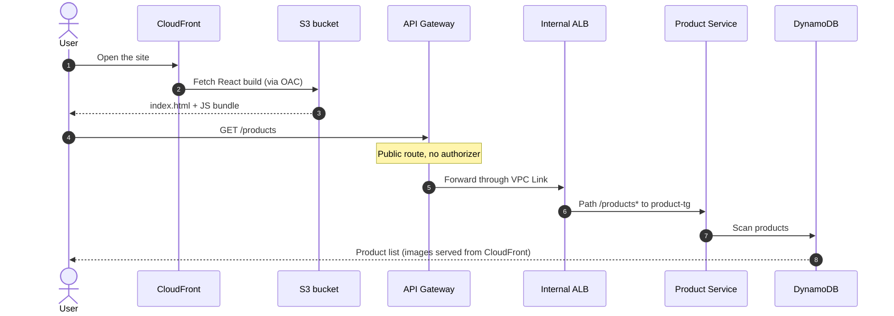
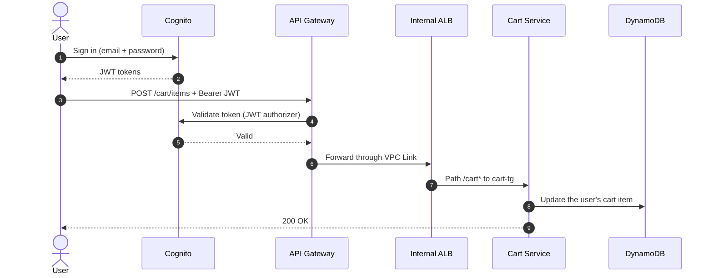
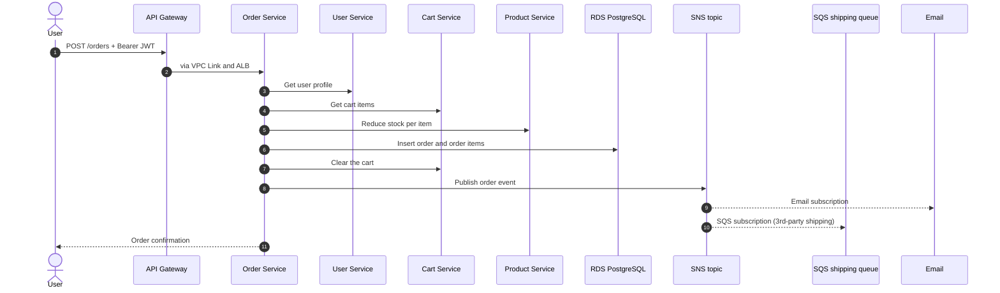

# Cloud-Native E-commerce Platform on AWS

**A microservices e-commerce application deployed end to end on AWS — React on S3 + CloudFront, four containerized FastAPI services on ECS Fargate behind an internal ALB and API Gateway, Cognito authentication, DynamoDB + RDS PostgreSQL, and event-driven order notifications with SNS and SQS.**


-232F3E)


<p align="center">
  
</p>

---

## Table of contents

- [Cloud-Native E-commerce Platform on AWS](#cloud-native-e-commerce-platform-on-aws)
  - [Table of contents](#table-of-contents)
  - [Overview](#overview)
  - [Architecture](#architecture)
  - [AWS services used](#aws-services-used)
  - [Microservices](#microservices)
  - [How a request flows](#how-a-request-flows)
    - [1 · Browsing the catalogue (public)](#1--browsing-the-catalogue-public)
    - [2 · Adding to the cart (authenticated)](#2--adding-to-the-cart-authenticated)
    - [3 · Placing an order and notifying](#3--placing-an-order-and-notifying)
  - [Network design](#network-design)
  - [Security design](#security-design)
  - [Deployment walkthrough](#deployment-walkthrough)
  - [Result](#result)
  - [Gotchas and troubleshooting](#gotchas-and-troubleshooting)
  - [Design decisions and what I would improve](#design-decisions-and-what-i-would-improve)
  - [Seed data and helper scripts](#seed-data-and-helper-scripts)
  - [Clean-up](#clean-up)
  - [Repository structure](#repository-structure)
  - [Acknowledgements](#acknowledgements)

---

## Overview

This project takes a multi-tier e-commerce store from source code to a **fully working, production-style deployment on AWS**, built by hand in the AWS console (with CLI equivalents documented in the guides).

Customers can browse a product catalogue, sign up and log in, fill a shopping cart, place an order, and receive an order notification e-mail. Behind the scenes the app is split into independent services that deploy and fail independently.

**What this project demonstrates**

| Area | What I built |
| :--- | :--- |
| **Networking** | Custom VPC across 2 AZs with public, private-app and isolated database subnets, NAT Gateway, per-tier route tables |
| **Containers** | 4 Dockerfiles, images in Amazon ECR, ECS Fargate cluster, 4 services with task definitions and health checks |
| **Traffic management** | Internal Application Load Balancer with path-based routing; API Gateway HTTP API reaching it privately through a VPC Link |
| **Authentication** | Cognito user pool + JWT authorizer on API Gateway; the React app signs users in with AWS Amplify |
| **Data** | DynamoDB for products and carts, RDS PostgreSQL for users and orders — each service uses the database that fits its access pattern |
| **Static delivery** | React build in a private S3 bucket served by CloudFront through Origin Access Control, with SPA-aware error handling |
| **Configuration & secrets** | Systems Manager Parameter Store (String + SecureString) loaded by the services at start-up |
| **Event-driven integration** | Order Service publishes to SNS, which fans out to an e-mail subscription and an SQS shipping queue |
| **Operations** | CloudWatch Logs for every container, ALB health checks, a scripted build → push → redeploy loop |

---

## Architecture


The application is organised in five layers:

| Layer | Components | Responsibility |
| :--- | :--- | :--- |
| **Frontend** | S3, CloudFront (Route 53 in the original design) | Serve the React single-page app over HTTPS from the edge |
| **API / access** | API Gateway (HTTP API), Cognito JWT authorizer, VPC Link, internal ALB | One public entry point; authenticates calls and routes to the right service |
| **Backend** | ECS Fargate: Product, Cart, User and Order services | Business logic in private subnets, no public IPs |
| **Data** | DynamoDB, RDS PostgreSQL | Persistence |
| **Integration** | SNS, SQS | Asynchronous order events: customer e-mail and shipping-vendor queue |

> **Note:** the diagram includes Route 53 for a custom domain. I did not buy a domain, so the site is served from the default `*.cloudfront.net` domain.

---

## AWS services used

| Category | Services |
| :--- | :--- |
| Networking | VPC, subnets, Internet Gateway, NAT Gateway, route tables, security groups, VPC Link |
| Compute & containers | ECS on Fargate, Amazon ECR |
| Edge & delivery | CloudFront (OAC), S3 |
| API & routing | API Gateway (HTTP API), Application Load Balancer (internal) |
| Identity | Cognito User Pools, IAM roles |
| Databases | DynamoDB, RDS for PostgreSQL |
| Messaging | SNS, SQS |
| Configuration & observability | Systems Manager Parameter Store, CloudWatch Logs |

---

## Microservices

All four services are Python **FastAPI** apps packaged in a slim Docker image (`python:3.11-slim`, served by Uvicorn). Each exposes `GET /health`, which the ALB uses for health checks.

| Service | Port | Datastore | Endpoints | Responsibility |
| :--- | :---: | :--- | :--- | :--- |
| [**Product**](services/product-service) | 8001 | DynamoDB `ecommerce-products` | `GET /products` · `GET /products/{id}` · `PUT /products/{id}/inventory` | Catalogue and stock levels |
| [**Cart**](services/cart-service) | 8002 | DynamoDB `ecommerce-cart` | `GET /cart` · `POST /cart/items` · `PUT/DELETE /cart/items/{id}` · `DELETE /cart` | Per-user shopping cart |
| [**User**](services/user-service) | 8003 | RDS PostgreSQL | `POST/GET/PUT /users/profile` · `GET /users/{id}` · `GET /users/cognito/{sub}` | User profiles linked to Cognito identities |
| [**Order**](services/order-service) | 8004 | RDS PostgreSQL + SNS | `POST /orders` · `GET /orders` · `GET /orders/{id}` | Order orchestration and event publishing |

When running in AWS, each service loads its configuration (database host and password, peer-service URLs, SNS topic ARN, region) from **Parameter Store** under `/ecommerce/dev/…` at start-up, so no secrets are baked into images or task definitions.

The **React frontend** ([`frontend/react-app`](frontend/react-app)) uses React 19, React Router, Axios and AWS Amplify. Every API call attaches the Cognito JWT as a `Bearer` token.

---

## How a request flows

### 1 · Browsing the catalogue (public)



### 2 · Adding to the cart (authenticated)



### 3 · Placing an order and notifying



The Order Service calls its peers over the internal ALB, using URLs from Parameter Store. If publishing to SNS fails, the order is still saved — the failure is logged rather than blocking the customer.

---

## Network design


| Setting | Value |
| :--- | :--- |
| Region / AZs | `eu-west-2` · `eu-west-2a`, `eu-west-2b` |
| VPC | `ecommerce-vpc` · `10.10.0.0/16` |

| Tier | Subnets | CIDRs | Hosts | Internet path |
| :--- | :--- | :--- | :--- | :--- |
| **Public** | `ecommerce-public-1/2` | `10.10.0.0/24`, `10.10.1.0/24` | NAT Gateway | Internet Gateway |
| **Private – ECS** | `ecommerce-private-ecs-1/2` | `10.10.10.0/24`, `10.10.11.0/24` | Fargate tasks, internal ALB | Outbound only, via NAT |
| **Private – DB** | `ecommerce-private-db-1/2` | `10.10.20.0/24`, `10.10.21.0/24` | RDS PostgreSQL | **None** (isolated) |


---

## Security design

| Control | Implementation |
| :--- | :--- |
| **No public compute** | Fargate tasks run in private subnets with public IP disabled; the ALB is **internal** and reachable only through the API Gateway VPC Link |
| **Layered security groups** | `ecommerce-vpclink-sg` → `ecommerce-alb-sg` (HTTP 80 from the VPC CIDR) → `ecommerce-ecs-sg` (ports 8001–8004 **only from the ALB SG**) → `ecommerce-rds-sg` (PostgreSQL 5432 from the VPC CIDR) |
| **Database isolation** | RDS has public access disabled and lives in subnets with no internet route |
| **Authentication & authorization** | Cognito user pool; API Gateway **JWT authorizer** on `ANY /{proxy+}`. Only `GET /products` and CORS pre-flight are public |
| **Private frontend bucket** | S3 *Block Public Access* stays on; CloudFront reads the bucket through **Origin Access Control** and a bucket policy scoped to the distribution |
| **No secrets in code** | The DB password is a Parameter Store **SecureString**; images contain no credentials |
| **Dedicated task role** | Containers use an ECS task role instead of access keys (it is broader than least-privilege — see [improvements](#design-decisions-and-what-i-would-improve)) |

---

## Deployment walkthrough

The deployment is split into nine modules. Each guide lists the console steps **and CLI equivalents**; each section below summarises it with screenshots from my own deployment.

| # | Module | Guide |
| :--: | :--- | :--- |
| 1 | Networking — VPC, subnets, IGW, NAT, route tables | [deployment/01-networking.md](deployment/01-networking.md) |
| 2 | Authentication — Cognito user pool and app client | [deployment/02-cognito-authentication.md](deployment/02-cognito-authentication.md) |
| 3 | Frontend — S3 bucket, CloudFront, SPA error pages | [deployment/03-frontend-deployment.md](deployment/03-frontend-deployment.md) |
| 4 | Data layer — product images, DynamoDB, RDS, Parameter Store | [deployment/04-data-layer.md](deployment/04-data-layer.md) |
| 5 | Backend — ALB, target groups, ECR, ECS task definitions and services | [deployment/05-backend-deployment.md](deployment/05-backend-deployment.md) |
| 6 | API Gateway — VPC Link, JWT authorizer, routes, CORS | [deployment/06-api-gateway.md](deployment/06-api-gateway.md) |
| 7 | Frontend ↔ backend integration — config, rebuild, cache invalidation | [deployment/07-frontend-backend-integration.md](deployment/07-frontend-backend-integration.md) |
| 8 | Notifications — SNS topic, SQS queue, subscriptions | [deployment/08-notification.md](deployment/08-notification.md) |
| 9 | Clean-up | [deployment/09-cleanup.md](deployment/09-cleanup.md) |

<details>
<summary><b>Module 1 · Networking</b></summary>

Created the VPC, an Internet Gateway for the public subnets, six subnets across two AZs, a NAT Gateway for outbound traffic from the private ECS subnets, and **three route tables** (public → IGW, private-ECS → NAT, private-DB → local only).

<table>
  <tr>
    <td width="50%"><br><sub>Internet Gateway attached to the VPC</sub></td>
    <td width="50%"><br><sub>Six subnets: public, private-ECS, private-DB</sub></td>
  </tr>
  <tr>
    <td><br><sub>Planned layout: 2 AZs × 3 subnet tiers</sub></td>
    <td><br><sub>Private-ECS subnet associations</sub></td>
  </tr>
  <tr>
    <td><br><sub>Public route table → Internet Gateway</sub></td>
    <td><br><sub>Private-ECS route table → NAT Gateway</sub></td>
  </tr>
  <tr>
    <td><br><sub>NAT Gateway in a public subnet</sub></td>
    <td><br><sub>Isolated database route table</sub></td>
  </tr>
</table>

</details>

<details>
<summary><b>Module 2 · Authentication (Cognito)</b></summary>

A Cognito user pool with e-mail sign-in and self-registration, plus an SPA app client (no secret) with the SRP, password and refresh-token flows enabled.

<table>
  <tr>
    <td width="50%"><br><sub>User pool</sub></td>
    <td width="50%"><br><sub>App client authentication flows</sub></td>
  </tr>
</table>

</details>

<details>
<summary><b>Module 3 · Frontend hosting (S3 + CloudFront)</b></summary>

A private S3 bucket holds the React build. CloudFront serves it through Origin Access Control. Custom error responses map **403/404 → `/index.html`** so React Router deep links work on refresh.

<table>
  <tr>
    <td width="50%"><br><sub>Frontend bucket</sub></td>
    <td width="50%"><br><sub>CloudFront distribution</sub></td>
  </tr>
  <tr>
    <td><br><sub>SPA error-page rules</sub></td>
    <td><br><sub><code>npm run build</code> then <code>aws s3 sync</code></sub></td>
  </tr>
</table>

</details>

<details>
<summary><b>Module 4 · Data layer</b></summary>

Product images are uploaded to S3 and served through CloudFront; the catalogue is loaded into DynamoDB; RDS PostgreSQL stores users and orders in the isolated subnets; database settings go into Parameter Store. See [Seed data and helper scripts](#seed-data-and-helper-scripts).

<table>
  <tr>
    <td width="50%"><br><sub>DynamoDB: <code>ecommerce-products</code> and <code>ecommerce-cart</code></sub></td>
    <td width="50%"><br><sub>20 products loaded</sub></td>
  </tr>
  <tr>
    <td><br><sub>Product image delivered by CloudFront</sub></td>
    <td><br><sub>RDS PostgreSQL instance</sub></td>
  </tr>
  <tr>
    <td><br><sub>Product images under <code>images/products/</code></sub></td>
    <td><br><sub><code>update-product-image-urls.sh</code> pointing <code>products.json</code> at CloudFront</sub></td>
  </tr>
  <tr>
    <td><br><sub>Uploading images with the helper script</sub></td>
    <td><br><sub>DB configuration in Parameter Store</sub></td>
  </tr>
</table>

</details>

<details>
<summary><b>Module 5 · Backend on ECS Fargate</b></summary>

Built an **internal ALB** with four IP target groups and path-based listener rules, pushed four images to ECR, created the ECS task role and security group, registered task definitions (0.25 vCPU / 0.5 GB each) and launched four Fargate services in the private subnets.

| Path pattern | Target group | Port |
| :--- | :--- | :---: |
| `/products*` (also the default action) | `product-tg` | 8001 |
| `/cart*` | `cart-tg` | 8002 |
| `/users*` | `user-tg` | 8003 |
| `/orders*` | `order-tg` | 8004 |

<table>
  <tr>
    <td width="50%"><br><sub>ALB path-based routing rules</sub></td>
    <td width="50%"><br><sub>Four ECR repositories</sub></td>
  </tr>
  <tr>
    <td><br><sub>Four IP target groups (ports 8001–8004)</sub></td>
    <td><br><sub>Internal ALB with an HTTP:80 listener</sub></td>
  </tr>
  <tr>
    <td><br><sub>ECS task security group</sub></td>
    <td><br><sub>Task definitions</sub></td>
  </tr>
  <tr>
    <td><br><sub>All services running</sub></td>
    <td></td>
  </tr>
  <tr>
    <td><br><sub>ECS task role</sub></td>
    <td><br><sub>Service URLs in Parameter Store</sub></td>
  </tr>
</table>

Images are built and rolled out with [`services/build-and-deploy-services.sh`](services/build-and-deploy-services.sh) — it builds, tags and pushes to ECR, then forces a new ECS deployment:

```bash
bash services/build-and-deploy-services.sh <account-id> eu-west-2          # all four services
bash services/build-and-deploy-services.sh <account-id> eu-west-2 order    # just one
```

</details>

<details>
<summary><b>Module 6 · API Gateway</b></summary>

An HTTP API reaches the internal ALB through a **VPC Link**. A Cognito **JWT authorizer** protects everything except the public product listing.

| Route | Authorization |
| :--- | :--- |
| `GET /products` | None (public catalogue) |
| `ANY /{proxy+}` | JWT (Cognito) |
| `OPTIONS /{proxy+}` | None (CORS pre-flight) |

<table>
  <tr>
    <td width="50%"><br><sub>VPC Link</sub></td>
    <td width="50%"><br><sub>ALB integration over the VPC Link</sub></td>
  </tr>
  <tr>
    <td><br><sub>Cognito JWT authorizer</sub></td>
    <td><br><sub>Routes</sub></td>
  </tr>
  <tr>
    <td><br><sub>CORS configuration</sub></td>
    <td><br><sub><code>curl</code> against the public route returns the catalogue</sub></td>
  </tr>
</table>

</details>

<details>
<summary><b>Module 7 · Frontend ↔ backend integration</b></summary>

Put the Cognito and API Gateway values into [`aws-config.js`](frontend/react-app/src/aws-config.js), rebuilt the React app, synced it to S3 and invalidated the CloudFront cache (`/*`).

<table>
  <tr>
    <td width="50%"><br><sub>API URL in the frontend config</sub></td>
    <td width="50%"><br><sub>CloudFront invalidation <code>/*</code></sub></td>
  </tr>
</table>

</details>

<details>
<summary><b>Module 8 · Event-driven notifications (SNS + SQS)</b></summary>

An SNS topic `ecommerce-order-events` fans out to an **e-mail subscription** and an **SQS queue** `ecommerce-order-shipping` that stands in for a third-party shipping vendor. The topic ARN is stored in Parameter Store and read by the Order Service.

> Production e-mail would normally go through SES + Lambda, but a new SES account starts in sandbox mode. For this project SNS sends the e-mail directly.

<table>
  <tr>
    <td width="50%"><br><sub>SNS topic</sub></td>
    <td width="50%"><br><sub>SQS shipping queue</sub></td>
  </tr>
  <tr>
    <td><br><sub>Queue policy allowing the SNS topic to send messages</sub></td>
    <td><br><sub>Order event delivered by e-mail</sub></td>
  </tr>
  <tr>
    <td><br><sub>Topic ARN stored in Parameter Store</sub></td>
    <td></td>
  </tr>
</table>

</details>

---

## Result

The application running on CloudFront + API Gateway + ECS:

<table>
  <tr>
    <td width="33%"><br><sub><b>Catalogue</b> loaded from DynamoDB via the Product Service</sub></td>
    <td width="33%"><br><sub><b>Shopping cart</b> persisted per user in DynamoDB</sub></td>
    <td width="33%"><br><sub><b>Order history</b> stored in RDS PostgreSQL</sub></td>
  </tr>
</table>

CloudWatch Logs show the Cart Service handling the browser's requests (`OPTIONS` pre-flights followed by `POST /cart/items` and `GET /cart`) while the ALB health checks hit `/health` on every task:


---

## Gotchas and troubleshooting

| Symptom | Cause | Fix |
| :--- | :--- | :--- |
| Site loads but shows **"Error loading products"** ([screenshot](docs/images/frontend/05-first-load-before-api.png)) | The frontend goes live in Module 3, before the API exists (Module 6) | Expected at that stage. After creating the API, set the invoke URL in `aws-config.js`, rebuild and re-sync ([Module 7](deployment/07-frontend-backend-integration.md)) |
| Order is saved but no e-mail arrives; logs show **`InvalidParameter: TopicArn`** ([screenshot](docs/images/messaging/05-publish-error-before-restart.png)) | The Order Service reads Parameter Store **at start-up**, so it did not yet know the topic ARN | Store the ARN in Parameter Store, then **restart the service** (new deployment); the e-mail then arrives ([screenshot](docs/images/messaging/06-order-email-received.png)) |
| Frontend changes don't appear after a redeploy | CloudFront is serving cached objects | Create an invalidation for `/*` (Module 7) |
| A refresh on a deep link returns an error | The path doesn't exist as an object in S3 | Custom error responses mapping 403/404 to `/index.html` (Module 3) |

---

## Design decisions and what I would improve

**Decisions**

- **Right database per service:** key-value access patterns (catalogue, cart) → DynamoDB; relational data (users, orders) → PostgreSQL.
- **API Gateway + VPC Link + internal ALB** instead of a public ALB: the backend has no public surface, and authentication is enforced once at the edge.
- **Path-based routing on one ALB** instead of one load balancer per service: cheaper and a single listener to manage.
- **Parameter Store** instead of hard-coded environment variables: one place to change configuration, with encryption for the password.
- **SNS fan-out** so new consumers (analytics, fulfilment) can be added without touching the Order Service.

**Improvements I would make for production**

- Add a **custom domain with HTTPS** (Route 53 + ACM) for CloudFront and the API.
- Replace the broad managed policies on the ECS task role (`AmazonDynamoDBFullAccess_v2`, `AmazonSNSFullAccess`, …) with **least-privilege policies** scoped to specific tables, parameters and topics, with a separate role per service.
- Make RDS **Multi-AZ** with automated backups and encryption (turned off here for a low-cost dev environment) and move the password to Secrets Manager with rotation.
- Run **more than one task per service** with ECS Service Auto Scaling; add CloudWatch alarms and dashboards.
- Add a **dead-letter queue** to the shipping queue, and use SES + Lambda for customer e-mail once out of the SES sandbox.
- Restrict the RDS security group to the ECS security group instead of the whole VPC CIDR.
- Define the infrastructure as code (Terraform / CDK) and automate build → test → deploy with a CI/CD pipeline.

---

## Seed data and helper scripts

The [`data/`](data) folder contains everything needed to populate the store. Run the scripts from inside `data/`:

| Script | What it does |
| :--- | :--- |
| [`download-product-images.sh`](data/download-product-images.sh) | Downloads 20 sample product photos from Unsplash into `product-images/` (not committed to Git) |
| [`upload-images-to-s3.sh`](data/upload-images-to-s3.sh) | Uploads them to `s3://<bucket>/images/products/` |
| [`update-product-image-urls.sh`](data/update-product-image-urls.sh) | Rewrites every `image_url` in `products.json` to point to **your** CloudFront domain |
| [`load-products.sh`](data/load-products.sh) | Creates the `ecommerce-products` and `ecommerce-cart` DynamoDB tables (on-demand) if missing and loads the 20 products |

```bash
cd data
bash download-product-images.sh
bash upload-images-to-s3.sh <frontend-bucket> eu-west-2
bash update-product-image-urls.sh https://<your-cloudfront-domain>
bash load-products.sh eu-west-2
```

`products.json` contains a `<your-cloudfront-domain>` placeholder, which is why the URL-update step is part of the flow.

---

## Clean-up

[deployment/09-cleanup.md](deployment/09-cleanup.md) lists the **exact deletion order** (notification → API → ECS → ECR → ALB → IAM → RDS → DynamoDB/SSM → CloudFront/S3 → Cognito → networking) so nothing is left behind.

---

## Repository structure

```text
.
├── README.md                          ← you are here
├── services/                          Backend microservices (FastAPI + Dockerfile each)
│   ├── product-service/
│   ├── cart-service/
│   ├── user-service/
│   ├── order-service/
│   └── build-and-deploy-services.sh   Build → push to ECR → redeploy on ECS
├── frontend/
│   └── react-app/                     React 19 SPA (Amplify auth, Axios, React Router)
├── data/                              Seed data + upload / load scripts
├── deployment/                        Step-by-step guides (console + CLI), modules 1–9
└── docs/images/                       Architecture diagrams and deployment screenshots
    ├── architecture/  networking/  auth/  frontend/  data/
    └── backend/  api-gateway/  integration/  messaging/  results/
```

---

## Acknowledgements

The application code and the module structure come from the AWS community **"Let's Build on AWS"** e-commerce series. I deployed the whole stack myself in my own AWS account (London region), adapted the guides, scripts and documentation, and captured the screenshots shown here.

