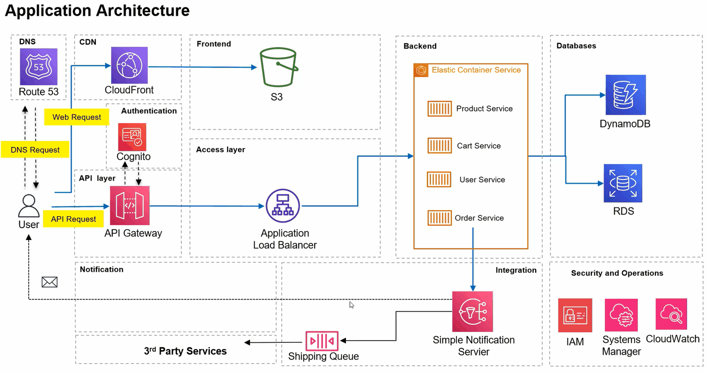

# Deployment Guide
## Overview
This guide walks you through deploying a production-ready microservices ecommerce application on AWS using modern cloud architecture patterns.

## Architecture Overview

## Deployments

Completed the following deployments in order:

### [ 1: Networking Foundation](./01-networking.md)

**Services:** VPC, Subnets, Internet Gateway, NAT Gateway, Route Tables
- Create VPC with public and private subnets across 2 AZs
- Set up Internet Gateway and NAT Gateway for connectivity

### [ 2: Authentication](./02-cognito-authentication.md)

**Services:** Cognito User Pools
- User registration and authentication
- JWT token management

### [ 3: Frontend Deployment](./03-frontend-deployment.md)

**Services:** S3, CloudFront
- S3 bucket for static website hosting
- CloudFront distribution for CDN and HTTPS

### [ 4: Data Layer](./04-data-layer.md)

**Services:** DynamoDB, RDS PostgreSQL, S3
- DynamoDB tables for products and cart data
- RDS PostgreSQL for users and orders
- S3 bucket for product images

### [ 5: Container Deployment](./05-backend-deployment.md)

**Services:** ECR, ECS, Fargate, Internal ALB, Parameter Store
- Build and push Docker images
- Deploy microservices on ECS Fargate with Parameter Store configuration
- Configure internal load balancing

### [ 6: API Gateway](./06-api-gateway.md)

**Services:** API Gateway, VPC Link
- Create unified API endpoint with VPC Link
- Integrate Cognito authentication
- Route requests to internal ALB

### [ 7: Frontend-Backend Integration](./07-frontend-backend-integration.md)

**Services:** S3, CloudFront
- Configure `aws-config.js` with Cognito and API Gateway values
- Build and deploy React application to S3
- Invalidate CloudFront cache

### [ 8: Event-Driven Architecture](./08-notification.md)

**Services:** SNS, SQS
- Direct SNS email notifications
- SQS logging for order events

### [ 9: Cleanup](./09-cleanup.md)

- Remove all AWS resources

## Let's get started
Let's begin with  **[network configurations](01-networking.md)**.
